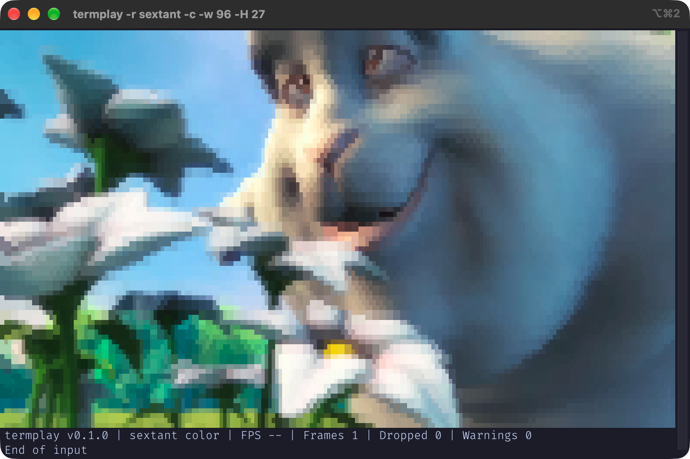

# WebRTC ASCII Video Client

Watch a WebRTC video stream in a terminal. `webrtc-ascii-client` connects to a Janus gateway, a WHEP server
such as MediaMTX, or your own signaling server, decodes the H.264 video and draws it as text: ASCII art,
Unicode blocks, braille or sextants, or real images on terminals that support Sixel or iTerm2 graphics.

It's for situations where there's no browser: a headless machine, an SSH remote session, and the need for
a quick check that a camera or a stream is alive.
It's also just for fun, because watching video as text is cool.
It is one binary with no runtime dependencies besides the FFmpeg libraries it links.

It is not a general video player: it plays WebRTC video only, without audio. To watch files or RTSP/HLS
streams in a terminal, see [Alternatives](#alternatives).



*`termplay -r sextant -c` showing a frame of Big Buck Bunny (© Blender Foundation, CC BY 3.0) in a 96×29
iTerm2 3.7.4 window, Fira Code Light 13. The same renderers draw WebRTC video. Taken with
[`internal/tools/rendercompare/screenshot.sh`](internal/tools/rendercompare/screenshot.sh).*

## Quick start

You need Go 1.27 or newer, a C compiler and the FFmpeg development libraries:

```bash
# macOS (Homebrew)
brew install go ffmpeg pkg-config

# Debian / Ubuntu (Go 1.27 from https://go.dev/dl/ if your distribution has an older one)
sudo apt install build-essential pkg-config libavcodec-dev libavutil-dev libswscale-dev
```

Install:

```bash
CGO_ENABLED=1 go install github.com/digitalemagine/webrtc-ascii-client/cmd/webrtc-ascii-client@latest
```

Try it without a server: the demo plays a moving test pattern; press `1`–`7` to switch renderers, `c` for
color, `q` to quit.

```bash
webrtc-ascii-client -demo -i
```

Then point it at a stream:

```bash
# WHEP, e.g. MediaMTX stream "mystream"
webrtc-ascii-client http://localhost:8889/mystream/whep

# Janus streaming plugin, mountpoint 1
webrtc-ascii-client ws://localhost:8188 1

# Your own signaling server (Simple protocol), session "myroom"
webrtc-ascii-client ws://localhost:8080/ws myroom
```

The protocol is chosen from the URL (`-adapter` overrides it). Add `-r sextant -c` for a sharper picture in
color, `-i` for keyboard controls.

## Renderers

| Renderer | Draws with | Size in |
|---|---|---|
| `classic` | ASCII characters by brightness | characters |
| `enhanced` | ASCII with supersampling and dithering, optional color | characters |
| `blocks` | Unicode half blocks, 2 pixels per cell | characters |
| `sextant` | Unicode sextants, 2×3 pixels per cell (needs a Unicode 13 font) | characters |
| `braille` | Braille dots, 2×4 per cell | characters |
| `sixel` | Sixel images, 256 colors | pixels |
| `iterm2` | iTerm2 inline images, 24-bit color (iTerm2, WezTerm) | pixels |

Every frame is written to the terminal, so over a slow link pick a light renderer: at 80×24 and 30 FPS
`classic` writes about 60 KB/s, color `blocks` about 2 MB/s ([measurements](docs/BANDWIDTH_ANALYSIS.md)).

## Two more commands

Both are pure Go, without FFmpeg or cgo:
`go install github.com/digitalemagine/webrtc-ascii-client/cmd/webrtc-recv@latest` (or `cmd/termplay`).

- **`webrtc-recv`** connects the same way but doesn't decode: it writes the H.264 stream to stdout or a file,
  for recording or for ffmpeg, ffplay and GStreamer.

  ```bash
  webrtc-recv http://localhost:8889/mystream/whep > stream.h264
  ```

- **`termplay`** plays video from a pipe with the same renderers and keys. It's mostly a way to try the
  renderers on your own video; for everyday viewing, mpv and timg do more.

  ```bash
  ffmpeg -v error -nostdin -re -i talk.mp4 -pix_fmt yuv420p -f yuv4mpegpipe - | termplay -r sextant -c
  ```

The renderers are also a Go package, [`encode`](encode/encode.go): an image in, terminal output out, pure Go
and deterministic. Its sextant renderer borrows notcurses' color algorithm; in a small comparison its output
came out close to ncplayer's and held up well next to chafa's ([comparison](docs/RENDERER_COMPARISON.md)).

## Alternatives

Yes, there are other, better options!

- **Files and RTSP/HLS streams in a terminal:** [mpv](https://mpv.io/manual/master/) `--vo=tct` (or
  `sixel`, `kitty`), [timg](https://github.com/hzeller/timg), notcurses'
  [ncplayer](https://github.com/dankamongmen/notcurses), [chafa](https://hpjansson.org/chafa/) for images
  and GIFs. They play anything FFmpeg reads, with more output formats than this tool.
- **MediaMTX without WebRTC:** MediaMTX also serves RTSP and HLS, so `mpv --vo=tct rtsp://host:8554/stream`
  works without this tool.
- **WebRTC in a window:** GStreamer's `whepsrc`, a browser, or `webrtc-recv` piped into ffplay.

Most of this can be had by piping: GStreamer's `whepsrc` into a terminal player for WHEP, or `webrtc-recv`
into mpv for any of the servers here. What this tool adds is Janus and custom signaling next to WHEP,
renderers and size you can change while it runs, and adaptive quality, in one binary (plus the FFmpeg
libraries), without GStreamer.

## Limitations

- H.264 only; VP8 and VP9 tracks are rejected.
- No audio. I don't plan to add it unless someone has a real use case
  ([what it would take](docs/ARCHITECTURE.md#audio)).
- Made for macOS and Linux. `webrtc-recv` and `termplay` also build for Windows (untested there), without the
  keyboard controls.
- Color needs a terminal with 24-bit color.
- No authentication: no WHEP bearer token, no Janus token, API secret or mountpoint PIN, and no TURN. The
  server has to accept anonymous viewers.

## About this project

I started this because I needed to check WebRTC remote camera feeds through an SSH terminal session,
where a browser wasn't an easy option, and often all I needed was to see that a camera was sending video
and a rough idea of the content. It grew from there mostly out of curiosity:
more renderers, other signaling servers, the two small companion tools.

Most of the code and the docs were written with an AI assistant (Claude Code). My role was the usual one
when I work with Claude on a curiosity project with a limited budget: not letting it go wild.
I steered the direction, reviewed plans before any code, challenged answers, iterated, reviewed the changes,
and checked assumptions against the real cameras and servers I had available.

I'm sharing it as an experiment, in case it's useful to someone else.
Other tools do much of the same and are more mature: see the [alternatives](#alternatives). It's a 0.1: it
does the job I wrote it for, and it surely has rough edges I haven't found yet. Feedback is welcome
([contributing](CONTRIBUTING.md)).

Getting rid of FFmpeg (maybe only for Constrained Baseline) could be my next experiment, but a decoder inside
the binary raises H.264 patent questions I'd rather stay away from. For now the project is source only, and
you build it against your own FFmpeg ([details](docs/DEPENDENCY_ANALYSIS.md#licenses-and-patents)).

## Documentation

- [Usage](docs/USAGE.md): options, keys, renderers, terminal support; `webrtc-recv` and `termplay`
- [Signaling](docs/SIGNALING.md): Janus, WHEP and the Simple protocol for your own server
- [Bandwidth](docs/BANDWIDTH_ANALYSIS.md): terminal output per renderer
- [Renderer comparison](docs/RENDERER_COMPARISON.md): sextant and braille next to chafa and ncplayer
- [Contributing](CONTRIBUTING.md): building, testing, and how the code is organized
  ([architecture](docs/ARCHITECTURE.md), [dependencies](docs/DEPENDENCY_ANALYSIS.md))
- [Changelog](CHANGELOG.md)

## License

[MIT](LICENSE)
