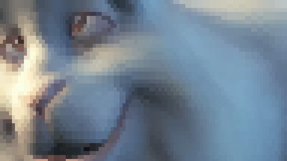
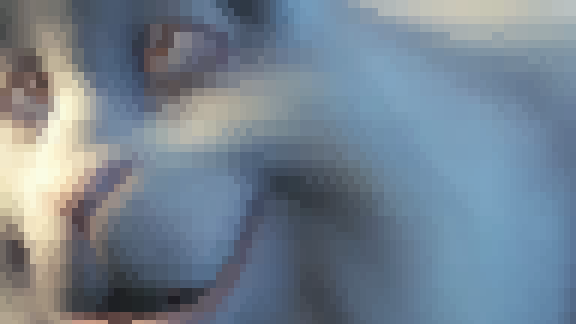
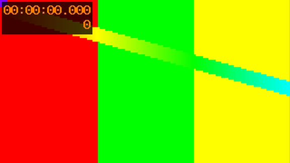
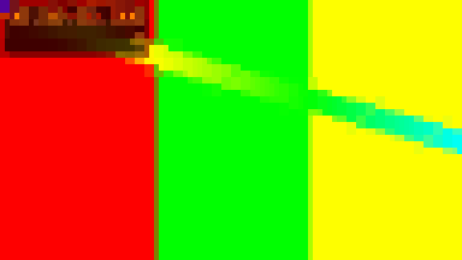
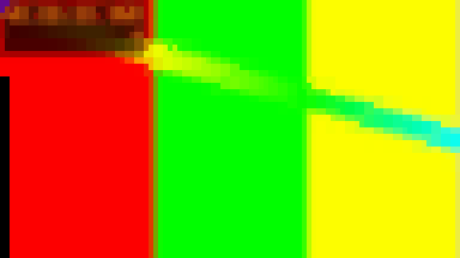
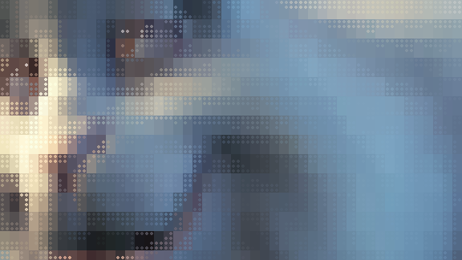
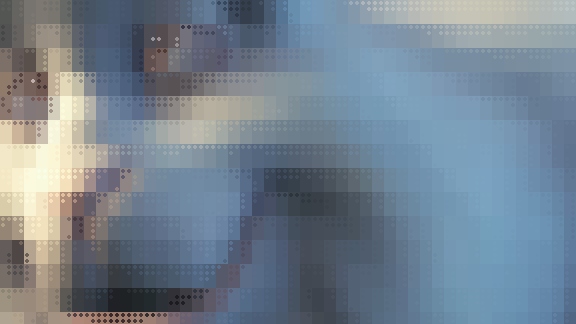
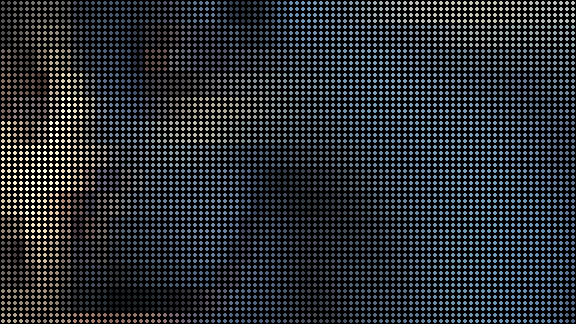

# Sextant and braille compared with chafa and ncplayer

How the `sextant` and `braille` renderers (the [`encode`](../encode/encode.go) package) compare with two
established tools that draw pictures with the same characters: [chafa](https://hpjansson.org/chafa/) and
notcurses' [ncplayer](https://github.com/dankamongmen/notcurses). Our sextant renderer uses the color
partitioning algorithm from notcurses, so ncplayer is the closest reference. I wanted to know whether the
renderers were good enough to offer as a package before saying so; both tools do much more than this one.

Measured 2026-10-10 on macOS 27 (arm64): chafa 1.18.3, notcurses 3.0.17, FFmpeg 9.0.2, tmux 3.8.
[`internal/tools/rendercompare/run.sh`](../internal/tools/rendercompare/run.sh) reproduces every number and
picture here.

## Summary

- **Sextant, same input:** when every tool gets the picture already scaled to the sextant pixel grid (2×3
  pixels per cell), our output and ncplayer's are practically the same, within 0.25 dB PSNR on every
  picture. Both are ahead of chafa by 2–3 dB on the film frames and the photograph, 1–1.5 dB on the
  gradient and the Mandelbrot set, and 10 dB on a test pattern with sharp edges.
- **Sextant, each tool scaling a large picture itself:** the three are within 0.3 dB of each other on the
  film frames and the photograph. chafa at `-w 9` (its most accurate setting) is slightly ahead on some
  of them; ours and ncplayer are ahead on the gradient and the test pattern.
- **Braille in color:** like chafa, each cell gets two colors (dots and background); by eye the result is
  close to chafa's. ncplayer draws every dot and colors only the dots, which is smaller but darker.
  Braille isn't scored: dots don't fill their cell, so a pixel metric mostly measures how the dots are
  drawn.
- **Size:** our sextant output is 3–10% larger than chafa's and about the same as ncplayer's; on the
  test pattern it is 31–36% smaller than chafa's.

## Method

- **Pictures** (640×360): three frames from Big Buck Bunny (the bunny's face at 75 s, a meadow at 180 s,
  trees at 465 s), the "Earthset" photograph from Artemis II, and three generated with FFmpeg: a smooth
  color gradient, the Mandelbrot set, and the `testsrc2` test pattern.
- **Grid:** 96×27 cells (16:9 with cells twice as tall as wide), 24-bit color. Sextant is 192×81 pixels,
  braille 192×108.
- **Two setups.** *Same input:* every tool gets the picture already scaled to the pixel grid (area
  averaging), so only the step from pixels to characters differs. That step is what `encode` does.
  *Native:* every tool gets the 640×360 picture and scales it itself, as a user would see it.
- **Settings:** ours `-r sextant -c` / `-r braille -c`; `chafa -f symbols -c full --symbols sextant`
  (or `braille`) `--stretch`, at its default effort and at `-w 9`; `ncplayer -b sex` (or `braille`) with
  `-s none` for the same input and `-s stretch` for native. `--color-space din99d` gives chafa the same
  output in 24-bit color, so it isn't listed.
- **Capture:** each tool's output is replayed in a tmux pane of the grid's size and captured with
  `capture-pane -e -N`. ncplayer runs on a pseudo-terminal that answers its startup queries as the foot
  terminal: without a terminal it uses half blocks instead of sextants, and in tmux 3.8 it waits for a
  reply that never comes.
- **Drawing:** the captured screen is drawn without a font, 12×24 pixels per cell: sextants and block
  elements as exact rectangles, braille as round dots. How fonts draw these characters varies a lot
  between terminals, and the comparison shouldn't depend on one.
- **Scores** (higher is better): PSNR in dB and SSIM, from FFmpeg. For the same input, against the input
  itself, after scaling the drawing back to the pixel grid (exact, since each sextant pixel is a 6×8
  rectangle). For native, against the original picture scaled to the drawing's size, so that no tool's
  scaler is the reference.
- **Bytes:** what each tool writes for the frame, without ncplayer's terminal queries.

## Sextant results

PSNR in dB / SSIM. Same input, scored at the pixel grid:

| Picture | ours | chafa | chafa -w 9 | ncplayer |
|---|---:|---:|---:|---:|
| Bunny | 31.8 / 0.978 | 28.9 / 0.964 | 29.0 / 0.965 | 31.8 / 0.978 |
| Meadow | 35.6 / 0.973 | 33.2 / 0.953 | 33.3 / 0.955 | 35.6 / 0.973 |
| Trees | 33.1 / 0.958 | 30.5 / 0.917 | 30.6 / 0.919 | 33.1 / 0.958 |
| Earthset | 38.8 / 0.981 | 35.5 / 0.703 | 35.5 / 0.712 | 38.7 / 0.981 |
| Gradient | 46.3 / 0.990 | 45.1 / 0.992 | 45.1 / 0.992 | 46.5 / 0.991 |
| Mandelbrot | 30.3 / 0.982 | 28.9 / 0.974 | 28.9 / 0.975 | 30.3 / 0.982 |
| testsrc2 | 34.0 / 0.992 | 23.6 / 0.865 | 23.4 / 0.865 | 34.0 / 0.991 |

Native (each tool scales the 640×360 picture), scored against the original picture at display size:

| Picture | ours | chafa | chafa -w 9 | ncplayer |
|---|---:|---:|---:|---:|
| Bunny | 27.4 / 0.801 | 27.5 / 0.802 | 27.6 / 0.804 | 27.5 / 0.800 |
| Meadow | 28.9 / 0.771 | 29.0 / 0.771 | 29.1 / 0.774 | 29.1 / 0.767 |
| Trees | 24.9 / 0.630 | 24.9 / 0.628 | 25.0 / 0.634 | 24.9 / 0.622 |
| Earthset | 29.7 / 0.814 | 29.6 / 0.535 | 29.7 / 0.545 | 29.8 / 0.808 |
| Gradient | 44.8 / 0.982 | 44.0 / 0.982 | 44.0 / 0.982 | 45.3 / 0.983 |
| Mandelbrot | 23.3 / 0.880 | 23.1 / 0.877 | 23.3 / 0.879 | 23.3 / 0.875 |
| testsrc2 | 23.5 / 0.911 | 21.1 / 0.845 | 21.3 / 0.857 | 23.7 / 0.873 |

The native scores are lower for everyone: they include what is lost by drawing 640×360 pixels with
192×81. chafa's low SSIM on Earthset comes from the black sky: SSIM magnifies differences of one or two
levels in near-black areas, while PSNR shows them as small.

Bytes per frame, same input:

| Picture | ours | chafa | chafa -w 9 | ncplayer |
|---|---:|---:|---:|---:|
| Bunny | 102,754 | 97,644 | 97,565 | 102,822 |
| Meadow | 100,049 | 96,434 | 96,225 | 100,327 |
| Trees | 92,738 | 88,370 | 88,494 | 92,967 |
| Earthset | 54,864 | 50,017 | 51,584 | 56,144 |
| Gradient | 103,262 | 99,355 | 99,355 | 103,564 |
| Mandelbrot | 104,731 | 100,182 | 100,194 | 105,146 |
| testsrc2 | 19,604 | 30,816 | 28,525 | 20,327 |

## Pictures

Crops of 48×13.5 cells, unscaled (12×24 pixels per cell), same input. Sextant:

| Picture | ours |
|---|---|
|  |  |
| **chafa -w 9** | **ncplayer** |
|  |  |

Sharp edges (`testsrc2`), where chafa's result differs most:

| Picture | ours |
|---|---|
|  |  |
| **chafa -w 9** | **ncplayer** |
|  |  |

Braille, in color:

| ours | chafa -w 9 | ncplayer |
|---|---|---|
|  |  |  |

## Limits

- Still pictures only. In video, ncplayer redraws only the cells that changed, so it writes less per frame
  than these numbers suggest; our encoder writes every cell of every frame.
- On screen, the font and the terminal matter as much as the encoder: some terminals draw sextants
  themselves, others take them from the font, with visible seams in some fonts.
- PSNR and SSIM are rough stand-ins for what people see. The pictures are there to check them.
- chafa offers many more symbol sets than sextants and braille; with its default symbols the result
  differs from what is measured here.

## Reproduce

```bash
brew install chafa notcurses tmux ffmpeg   # or your distribution's packages
internal/tools/rendercompare/run.sh /tmp/rendercompare
```

It downloads Big Buck Bunny (121 MB) and the NASA photograph, checks their SHA-256, and writes
`results.tsv`, every capture and drawing, and the crops shown above.

## Credits

- Big Buck Bunny: (c) copyright 2008, Blender Foundation / [www.bigbuckbunny.org](https://www.bigbuckbunny.org),
  [CC BY 3.0](https://creativecommons.org/licenses/by/3.0/). The pictures above are crops of its frames as
  drawn by each tool.
- "A Breathtaking Earthset from Orion" (art002e021278), NASA, 2026, from
  [images.nasa.gov](https://images.nasa.gov/details/art002e021278).
